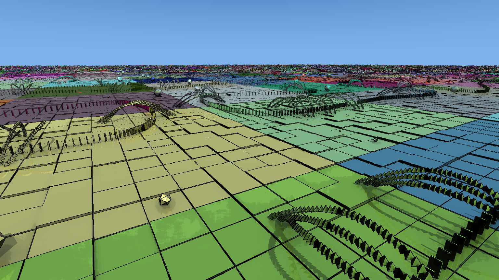

# DirectX Raytracing 2: partitioned TLAS

This sample demonstrates how to build, update, and trace a partitioned top-level acceleration structure (PTLAS) with D3D12. A scene of falling dominoes shows how sparse instance updates let quiet spatial partitions retain their acceleration structures while other partitions change.



## What you will learn

- Choose partition capacities and allocate PTLAS result and scratch buffers.
- Build the initial PTLAS with stable instance indices.
- Generate compact `WRITE_INSTANCE` records and their count on the GPU.
- Update the existing PTLAS in place, with the required resource transitions and barriers.
- Move dynamic instances between spatial partitions and the global partition.
- Compare PTLAS with regular TLAS refit or rebuild using the same scene and animation.
- Measure GPU update time as individual partitions become quiet.

Start with [the PTLAS walkthrough](PTLAS_WALKTHROUGH.md) for annotated code, a reading order, and experiments. It assumes familiarity with D3D12 command queues, root signatures, and ordinary DXR BLAS/TLAS builds.

## Requirements

- Windows and a GPU/driver supporting DXR 2 PTLAS.
- Visual Studio 2022 with **Desktop development with C++** and a Windows 10/11 SDK; build for x64 with C++17.
- A DXR 2 PTLAS-capable Agility SDK preview and a compatible DirectX Shader Compiler (DXC).
- NuGet package restore for DirectXTK12 and WinPixEventRuntime, pinned in [packages.config](packages.config). DirectXMath is supplied by the Windows SDK.

The Agility SDK and DXC are supplied separately from this sample. Use the headers
and runtime from the same Agility SDK version, together with a compatible DXC.

### SDK package availability

The public [DXR 2 ClusteredGeometry sample](../D3D12RaytracingClusteredGeometry/readme.md)
documents using a locally supplied Agility NuGet package until its public version
is available, then updating the package version and restoring from nuget.org.
Keep any local package source in Visual Studio's NuGet settings or a user-level
`NuGet.Config`; machine-specific feed locations should not be checked in.
The sample preserves inherited NuGet feeds. If direct access to nuget.org is
blocked, configure an appropriate feed in your user or machine NuGet settings.

<!-- SDK_RELEASE_TODO: Confirm the Agility SDK and DXC package IDs/versions and
     public availability with Microsoft, then finalize these instructions. -->

This sample currently uses an extracted SDK/toolchain directory via
`Dxr2SdkRoot`, rather than restoring Agility and DXC NuGet packages itself. That
directory must contain `include/d3d12.h`. The runtime and compatible DXC must be
in either `bin/` (the compact layout) or `x64/sdkbin/` (the full SDK layout).
That directory must contain `D3D12Core.dll`, `d3d12SDKLayers.dll`, `dxc.exe`,
`dxcompiler.dll`, and `dxil.dll`. Validation, shader compilation, and runtime
copying all use the same selected binary directory, without moving SDK files.
The NuGet restore described below currently installs only the helper
dependencies in `packages.config`.

<!-- SDK_RELEASE_TODO: Align Dxr2Preview.props, Dxr2Preview.targets and the project/
     package configuration with the selected Microsoft Agility/DXC package layout.
     Check D3D12_PREVIEW_SDK_VERSION and D3D12RaytracingPreview use in
     src/DXR2SampleMain.cpp, src/DeviceResources.cpp and tools/feature_probe.cpp
     against the shipping headers; these identifiers are intentional API uses.
     Preview-named files/default folders are existing build interfaces, not pins
     to a particular private SDK drop. -->

## Build and run

Open [D3D12RaytracingPartitionedTLAS.sln](D3D12RaytracingPartitionedTLAS.sln), restore NuGet packages, select **x64 / Release** or **x64 / Debug**, and build. F5 launches the full scene.

From this directory in PowerShell:

```powershell
.\tools\build.ps1 -Configuration Release
Set-Location bin\x64\Release
.\dxr_partitioned_tlas.exe --full
```

The build script discovers Visual Studio with `vswhere` and runs MSBuild with package restore. [Dxr2Preview.props](Dxr2Preview.props) looks for the preview SDK at `..\dxr2_preview`. To use another location:

```powershell
.\tools\build.ps1 -Configuration Release -Dxr2SdkRoot C:\path\to\preview
```

You can also set `Dxr2SdkRoot` in a Visual Studio user property sheet or pass `/p:Dxr2SdkRoot=...` to MSBuild. The projects compile HLSL directly with the preview DXC and copy the runtime, shader sources, compiled shaders, font, and license texts to the output directory.

To keep generated files outside the checkout, create an ignored `Dxr2Preview.local.props` next to the solution:

```xml
<Project xmlns="http://schemas.microsoft.com/developer/msbuild/2003">
  <PropertyGroup>
    <Dxr2SdkRoot>C:\path\to\preview</Dxr2SdkRoot>
    <Dxr2ArtifactsRoot>C:\path\to\sample-artifacts</Dxr2ArtifactsRoot>
  </PropertyGroup>
</Project>
```

Use `tools/build.ps1` to restore packages and build with these settings. Output, intermediates, and restored packages then go into `bin`, `obj`, and `packages` under `Dxr2ArtifactsRoot`; Visual Studio uses the same output and SDK paths. Without this override, those directories stay inside the checkout and are ignored by Git. Keep captures and logs in the output directory or another directory outside the checkout.

Run `dxr2_feature_probe.exe` to check preview feature enablement, find a hardware adapter with PTLAS support, and inspect the DXR 2 interfaces. The sample selects the first capable hardware adapter from DXGI's high-performance enumeration; `--adapter N` selects a specific ordinal.

## Scene and partition modes

The full scene contains **169,231 dominoes and 1,220,247 static instances** across a **50×50 partition grid**. Dominoes follow a Hilbert-curve path. Fixed random seeds make scenery placement and initial velocities repeatable. Physics runs five fixed substeps per frame, with ground contact, neighboring-domino collisions, and damping that lets the motion settle.

| Mode | Instance placement | Experiment |
| --- | --- | --- |
| 1 | Keep changed dominoes in their spatial partitions. | Observe update cost as fewer partitions contain motion. |
| 2 | Move active dominoes to the global partition; return them when quiet. | Compare update cost with tracing cost. |
| 3 | Use spatial partitions near the camera and the global partition farther away. | Adjust the near/far distance to explore the tradeoff. |

Partition hue identifies membership. Static scenery becomes more saturated when a domino associated with its spatial partition changes, then returns to its muted color ten rendered frames after the last modification. This indicates simulation activity; it is not a driver-reported rebuild counter. Dominoes turn red briefly after first contact.

Without `--full`, the sample starts with a 16×16 grid. `--axis N --partitions P --static-count S` configures that grid. With `--full`, use `--scene-size S --partitions P` to change its scale and partition grid, and `--static-count S` to cap the static instance count. Put overrides after `--full`.

## Controls

| Input | Action |
| --- | --- |
| F1 / F2 | Show help / open or close settings |
| Tab / Shift+Tab | Next / previous settings page |
| Up/Down, Left/Right | Select a setting, adjust its value; Shift makes larger changes |
| Enter | Activate the selected setting or action |
| P or Space / 1–3 | Toggle PTLAS/TLAS / select the partition mode |
| F / N / R | Pause / single step / reset motion |
| T / V / C | Toggle regular TLAS refit / VSync / partition colors |
| WASD, Q/E, Shift | Move horizontally, move vertically, move faster |
| Left drag / right click | Look around / topple the ray-traced domino |
| F5 / F12 | Reload shaders / save a DDS screenshot |
| Alt+Enter / Esc | Borderless fullscreen / quit |

The settings pages cover PTLAS/animation, scene generation, camera, and lighting. Camera shortcuts are suspended while the menu is open. Right-click toppling and **Topple selected domino** resume simulation. Scene regeneration rebuilds the scene in the same window.

`--self-topple-count N` controls the starting seeds: 2,000 for the full scene, one for the small grid. Zero leaves the scene still until a manual topple. `--mark-all` enables moving all dynamic members of an active partition together. `--no-partition-colors` disables coloring. Rendering uses 2× resolution and downsamples to the window; `--render-scale 1` renders at window resolution.

## Measure settling and update cost

From `bin/x64/Release`:

```powershell
./dxr_partitioned_tlas.exe --full --mode 1 --frames 6000 --no-vsync --csv settling.csv
```

Keep the camera and settings fixed. Watch **AS** time and the instance-write count: collisions spread first, then individual partitions become quiet, and finally writes reach zero. The PTLAS remains traceable. The sample still submits the update when there are no instance writes. Its GPU cost depends on the implementation. See [the settling experiment](PTLAS_WALKTHROUGH.md#watch-partitions-become-quiet).

`--csv` records GPU animation, AS update, trace, compositing, and combined times. **AS** is the acceleration-structure update stage; **update** includes both animation and AS work. Discard startup frames, use Release without `--debug` for timing, and compare equal frame ranges and settings. VSync is enabled by default; `--no-vsync` enables unthrottled rendering and tearing where supported. Timings exclude HUD drawing and presentation.

For the regular TLAS path, add `--tlas`; T switches between refit and rebuild. The first frame after changing AS paths performs synchronization, so exclude it from comparisons. PTLAS build hints are selected with `--ptlas-hint none`, `build`, or `trace`.

## Captures, diagnostics, and tests

- `--frames N` exits after N submitted frames.
- `--image PATH.dds --frames N` saves the final composited image at internal resolution, without the HUD or display downsampling.
- `--screenshot PATH.dds --frames N` saves the final displayed frame including the HUD. F12 saves to the same path, or to `screenshot.dds` by default.
- `--debug` enables the D3D12 debug layer and writes `dxr2_debug.log`. Debug builds enable it automatically. Validation errors cause a failing process exit.
- `--state-dump PATH --frames N` saves the final 96-byte state record for each domino. Set `PTLAS_SCENE_DUMP` to a path to save the initial scene records. [compare_dumps.py](tools/compare_dumps.py) compares captures from two sample runs.
- `--pick X Y` and `--reload-shaders` exercise picking and shader reload at launch.

Image capture waits for the GPU. Omit capture and state-dump options from timed runs. DirectXTK's upload helper emits a preview `DEPRECATED_API` warning for its legacy feature query; validation messages remain visible.

After a Release build, run the regression checks from the sample root:

```powershell
python tools/test_shader_reload.py
python tools/test_manual_topple.py
python tools/test_device_recovery.py
```

These exercise shader source discovery, failed compilation and pipeline creation, reload persistence, paused toppling, and device recovery. Python 3 is required for the tools; building and running the application does not require Python.

Each regression script accepts the sample executable path as its first argument when using a custom output directory.

## Shader reload and device recovery

F5 finds project shader sources when launched from a build inside the project; standalone copies use the bundled `shaders` directory. Reload compiles into memory and accepts the new bytecode only after every pipeline succeeds. On failure, rendering continues with the last accepted pipelines. Rebuild the project to persist shader edits for subsequent launches.

`DeviceResources` notifies `OnDeviceLost` and `OnDeviceRestored`. Recovery releases device resources and recreates the device, swapchain, BLAS, TLAS, PTLAS, buffers, shaders, descriptors, and UI. The simulation restarts; camera settings, user options, and the last accepted shader bytecode survive. If recovery cannot create a compatible device, the sample reports the failure and exits.

`--test-device-loss-frame N` removes the application's device after N submitted frames to exercise recovery. It does not reset the system GPU. Progress is written to `device_recovery.log`; discarded in-flight readbacks can leave gaps in CSV frame numbers.

## Acknowledgments

This sample is based on NVIDIA's [vk_partitioned_tlas](https://github.com/nvpro-samples/vk_partitioned_tlas) Vulkan sample by [Pascal Gautron](https://github.com/pgautron) and the nvpro-samples contributors. The original sample provides the foundation for the domino scene, physics simulation, and partition update modes demonstrated here.

## Scope and licenses

The sample demonstrates fixed-capacity PTLAS construction and sparse instance writes. Partition translations, instance deletion/streaming, explicit instance AABBs, and resizing are outside its scope. Consult the [DXR 2 specification](https://microsoft.github.io/DirectX-Specs/d3d/Raytracing2.html) for those operations and the complete API contract.

NVIDIA-owned sample code is provided under the [MIT License](LICENSES/MIT.txt),
matching Microsoft DirectX-Graphics-Samples. Original copyright and author
acknowledgments are retained. The inlined GLM Catmull-Rom helper, Microsoft font,
and build dependencies retain their applicable notices, documented in
[THIRD_PARTY_NOTICES.md](THIRD_PARTY_NOTICES.md).
